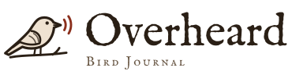
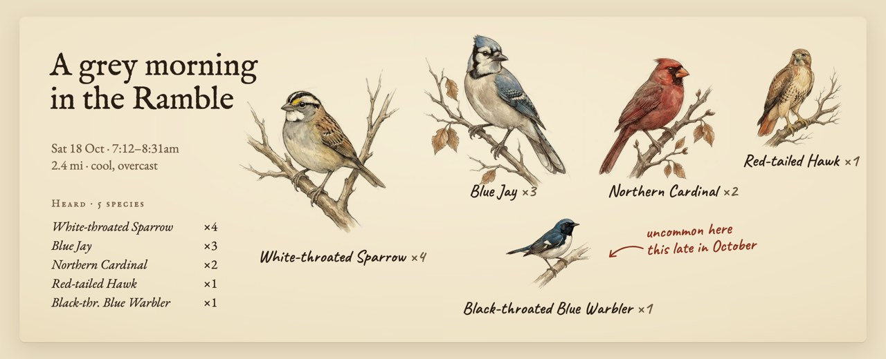
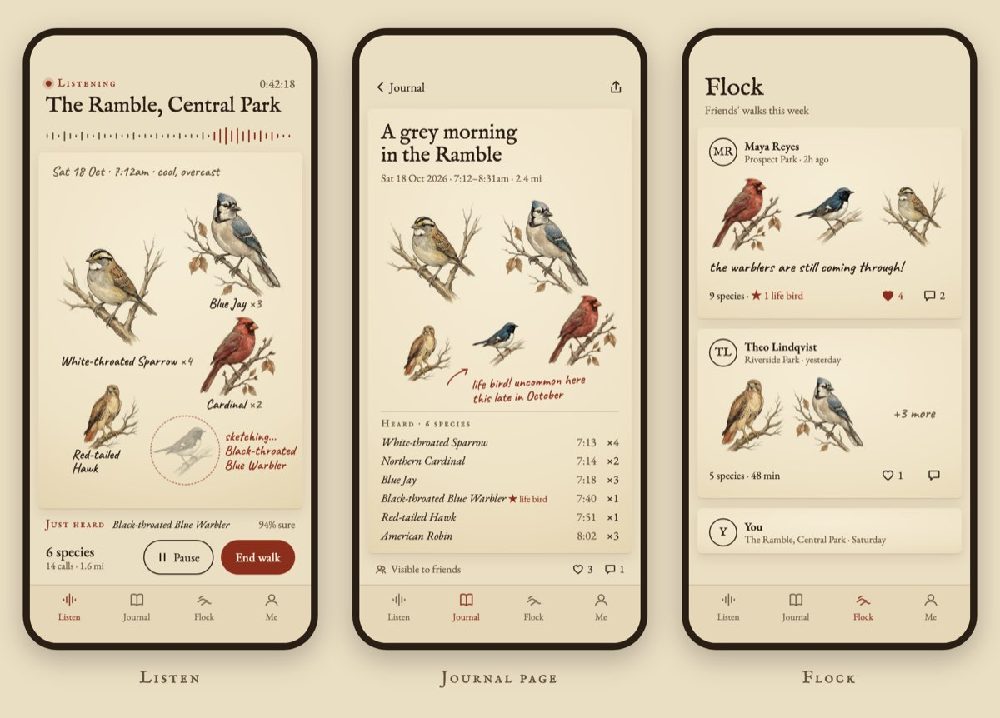
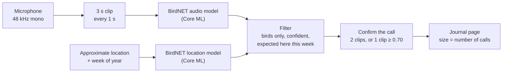

<p align="center">
  <picture>
    <source media="(prefers-color-scheme: dark)" srcset="docs/assets/logo-dark.svg">
    
  </picture>
</p>

<p align="center">
  <em>An iPhone app that listens on your walks, names the birds it hears, and draws the walk as a page in a field journal.</em>
</p>

<p align="center">
  <a href="https://github.com/JacksonDahl2/overheard/actions/workflows/ci.yml"></a>
  
  
  <a href="ml/models/coreml/README.md"></a>
  <a href="LICENSE"></a>
</p>

<p align="center">
  <picture>
    <source media="(prefers-color-scheme: dark)" srcset="docs/assets/hero-dark.jpg">
    
  </picture>
  <br>
  <sub>Concept art for a journal page. The bird illustrations are the project's own; the page itself is still being built.</sub>
</p>

## What it does

Start a walk and put your phone in your pocket. Overheard listens through the microphone and identifies birds by their songs and calls, entirely on the phone. No audio is uploaded, and identifying birds doesn't need a network connection.

When you get home, the walk becomes a journal page: ink-and-watercolor drawings of every bird you heard, clustered on parchment, each one sized by how many times it sang. A handwritten red-ink note marks anything unusual for the place and season ("uncommon here this late in October"). Friends can follow each other's walks and see what turned up.

Overheard is free, made for friends and family, and has no ads or monetization.

<p align="center">
  <picture>
    <source media="(prefers-color-scheme: dark)" srcset="docs/assets/mockups-dark.jpg">
    
  </picture>
  <br>
  <sub>Design mockups (<a href="design/mockups/">design/mockups/</a>), not screenshots. The app UI today is a plain detection list; this is where it's headed. Shown in the Parchment theme, or By Candlelight if your GitHub is in dark mode.</sub>
</p>

## How it works



- **Listening.** The app records 3-second clips, overlapping by 2 seconds, so a song that straddles a clip boundary is still heard whole.
- **Identifying.** Each clip goes through [BirdNET](https://github.com/birdnet-team/BirdNET-Analyzer) v2.4, converted to Core ML and running on the phone in about 21 ms per clip on an iPhone 17 Pro.
- **Location.** BirdNET's location model, also on the phone, estimates which of the 6,522 species it knows are likely at your position in the current week. That works anywhere in the world, and approximate location is enough.
- **Confirming.** A species counts once a call is heard in two clips above the threshold, or once in a single clip with confidence of at least 0.70. Until then it is "being sketched" and fades if it isn't confirmed. Detections less than 2.5 s apart merge into one call, so `×3` means three separate songs.

The pipeline lives in a Swift package, [`OverheardKit`](apps/ios/OverheardKit), that runs on both iOS and macOS. The same code powers the app and the evaluation tool, so anything measured on the Mac carries over to the phone exactly.

## Detection quality

`overheard-eval` runs the app's own pipeline over 110 labeled recordings of 22 Central Park species (5 each, from xeno-canto) and 26 no-bird noise clips (ESC-50). Each bird recording is also re-scored with city noise mixed underneath. Current defaults (threshold 0.50, location filter on, call confirmation):

| Condition | Recall | Precision | Wrong species per recording |
|---|---|---|---|
| Clean recording | 79.1% | 83.7% | 0.15 |
| City noise, bird clearly louder (+10 dB) | 75.5% | 83.8% | 0.15 |
| City noise, equally loud (0 dB) | 76.4% | 85.7% | 0.13 |
| City noise louder than the bird (−5 dB) | 75.5% | 86.5% | 0.12 |
| Clean, location filter **off** | 79.1% | 67.4% | 0.38 |

The location filter is worth about 16 points of precision: without it, most wrong answers are lookalike species from other continents.

These numbers are probably optimistic. xeno-canto recordings are likely part of BirdNET's training data, and they're cleaner than a real walk through a park. Field testing is still to come. The full history of each change and its effect is in [ml/eval/README.md](ml/eval/README.md).

## Status

Overheard is early. Here's an honest picture, kept in sync with [todo.md](todo.md):

**Working today**
- On-device detection: audio capture, BirdNET audio and location models in Core ML, overlapping clips, call merging and confirmation.
- Listening continues with the screen locked, through phone calls and when AirPods connect or disconnect (basic handling, still being verified on device).
- An evaluation harness that measures every change to detection quality.
- CI: unit tests, an unsigned iOS build, and Python lint.

**Next**
- Better detection: a confidence bar that rises for species that are unlikely at your location, and an adaptive noise gate.
- The walk flow, saving walks on the phone (SwiftData), the parchment UI and the journal page, with the "being sketched" reveal and rare-bird notes.
- Field tests in Central Park, and battery measurements.

**Later**
- A small backend on Cloudflare Workers (Hono, D1, R2) with Sign in with Apple.
- Following friends, a feed of walks, likes and comments.
- Seasonal and pose variations of the bird art.
- TestFlight, then the App Store.

## Repository layout

```
apps/ios/            SwiftUI app (XcodeGen) and the OverheardKit package: the detection pipeline, tests, eval CLI
ml/                  BirdNET → Core ML conversion and checks; models/coreml/ holds the built models (Git LFS)
ml/eval/             Evaluation data manifest and fetch script
design/mockups/      Screen mockups in both themes
art/                 Image-model trial for the bird illustrations
docs/                Design system, decision log, planned API
```

[AGENTS.md](AGENTS.md) has the detailed layout, conventions and gotchas.

## Getting started

You need a Mac with Xcode, [Git LFS](https://git-lfs.com) and [XcodeGen](https://github.com/yonaskolb/XcodeGen). Python is only needed to regenerate the models or download evaluation data.

```sh
git clone https://github.com/JacksonDahl2/overheard.git && cd overheard
git lfs install --local && git lfs pull        # the Core ML models, about 100 MB

cd apps/ios
cp Config/Local.xcconfig.example Config/Local.xcconfig   # set DEVELOPMENT_TEAM to your team ID
xcodegen                                       # generates Overheard.xcodeproj
open Overheard.xcodeproj                       # choose your iPhone and press ⌘R
```

A free Apple "Personal Team" is enough to run it on your own iPhone. [apps/ios/README.md](apps/ios/README.md) covers signing, Developer Mode and a field-test checklist.

```sh
swift test --package-path apps/ios/OverheardKit                                   # unit tests
swift run -c release --package-path apps/ios/OverheardKit overheard-eval --verbose # detection eval
```

The eval needs its recordings first; [ml/eval/README.md](ml/eval/README.md) explains how to fetch them (bird recordings need a free xeno-canto API key). To rebuild the models from BirdNET's TensorFlow release, see [ml/README.md](ml/README.md).

## Privacy

- **Audio never leaves the phone.** Identification happens on the device, and recordings aren't uploaded or kept.
- **Approximate location is enough.** It's only used to work out which birds are expected nearby.
- **When sharing arrives,** shared locations will be blurred to a ~500 m grid, the start and end of routes trimmed so they don't reveal your home, and sensitive species (owls, for example) shown without a location.

## Contributing

Contributions and bug reports are welcome. It's a small project, so for anything larger than a fix, please open an issue first to talk it over.

- Work on a branch (`feat/…`, `fix/…`, `docs/…`) and open a pull request against `main`. CI runs on every PR.
- Format before committing:
  ```sh
  xcrun swift-format format --in-place --recursive apps/ios/Overheard apps/ios/OverheardKit
  ml/.venv/bin/ruff format ml && ml/.venv/bin/ruff check --fix ml
  ```
- Detection logic goes in `OverheardKit` with unit tests. Measure quality changes with `overheard-eval` and include the before and after numbers in the PR.
- UI follows [docs/design.md](docs/design.md): its colors, fonts, and rules for laying out birds on the page.

[AGENTS.md](AGENTS.md) is the full guide for humans and coding agents alike, and [docs/decisions.md](docs/decisions.md) records why things are the way they are.

## Credits

- **[BirdNET](https://github.com/birdnet-team/BirdNET-Analyzer)** by the K. Lisa Yang Center for Conservation Bioacoustics at the Cornell Lab of Ornithology and Chemnitz University of Technology. Overheard would not exist without it.
- **Species names and codes** from the [eBird/Clements taxonomy](https://ebird.org).
- **Evaluation data** from [xeno-canto](https://xeno-canto.org) recordists and the [ESC-50](https://github.com/karolpiczak/ESC-50) environmental sound dataset.
- **Bird illustrations** were generated for this project with Gemini 3 Pro Image ([art/model-comparison/](art/model-comparison/)).
- **Fonts** in the design and logo: IM FELL English by Igino Marini, EB Garamond and Caveat, all under the SIL Open Font License.
- **Inspired by** [AvianVisitors](https://theodore.net/projects/AvianVisitors/).

## License

- **BirdNET-derived models** (`ml/models/coreml/`): the Core ML conversions of BirdNET v2.4 are adaptations licensed under [CC BY-NC-SA 4.0](https://creativecommons.org/licenses/by-nc-sa/4.0/), the same license as BirdNET itself. That means **non-commercial use only**, **credit required**, and **anything derived from them shares the same license**. See [ml/models/coreml/README.md](ml/models/coreml/README.md).
- **Code:** [MIT](LICENSE).
- **Bird illustrations** and the Overheard logo belong to the project owner and are not covered by the code license.
