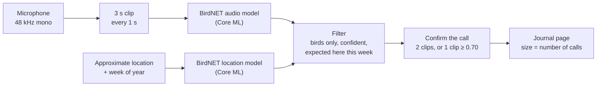

<p align="center">
  <picture>
    <source media="(prefers-color-scheme: dark)" srcset="docs/assets/logo-dark.svg">
    
  </picture>
</p>

<p align="center">
  <em>An iPhone app that listens on your walks, names the birds it hears, and draws the walk as a page in a field journal.</em>
</p>

<p align="center">
  <a href="https://github.com/JacksonDahl2/overheard/actions/workflows/ci.yml"></a>
  
  
  <a href="ml/models/coreml/README.md"></a>
  <a href="LICENSE"></a>
</p>

<p align="center">
  <picture>
    <source media="(prefers-color-scheme: dark)" srcset="docs/assets/hero-dark.jpg">
    
  </picture>
  <br>
  <sub>A design mockup of a journal page, made with the app's own bird drawings. The app doesn't draw this page yet.</sub>
</p>

## What it does

Start a walk and put your phone in your pocket. Overheard listens through the microphone and identifies birds by their songs and calls on the phone itself. No audio is uploaded, and it works without a network connection.

When the walk ends, it becomes a journal page with an ink-and-watercolor drawing of each bird you heard. The more times a bird called, the bigger its drawing. A handwritten red-ink note marks a bird that's unusual for the place and season, such as "uncommon here this late in October". Friends can follow each other's walks.

Overheard is free, made for friends and family, and has no ads or paid features.

<p align="center">
  <picture>
    <source media="(prefers-color-scheme: dark)" srcset="docs/assets/mockups-dark.jpg">
    
  </picture>
  <br>
  <sub>Design mockups from <a href="design/mockups/">design/mockups/</a>, not screenshots. The app currently shows a plain list of detections. Shown in the Parchment theme, or By Candlelight if GitHub is in dark mode.</sub>
</p>

## How it works



- **Listening.** The app takes a 3-second clip every second. Clips overlap by 2 seconds, so a song that crosses a clip boundary still fits whole in one clip.
- **Identifying.** Each clip goes through [BirdNET](https://github.com/birdnet-team/BirdNET-Analyzer) v2.4, converted to Core ML. It takes about 21 ms per clip on an iPhone 17 Pro.
- **Location.** BirdNET's location model, also on the phone, estimates how likely each of its 6,522 species is at your position in the current week. It works anywhere, and approximate location is enough. Species that are unlikely here need a higher confidence to count.
- **Confirming.** A species counts once a call is heard in two clips above the threshold, or in one clip with confidence of at least 0.70. Until then it shows as "sketching…" and fades if it isn't confirmed. Detections less than 2.5 s apart merge into one call, so `×3` means three separate songs.

The pipeline is a Swift package, [`OverheardKit`](apps/ios/OverheardKit), that builds for iOS and macOS. The app and the evaluation tool run the same code, so the eval measures what ships.

## Detection quality

`overheard-eval` runs the app's own pipeline over 110 labeled recordings of 22 Central Park species (5 each, from xeno-canto) and 26 no-bird noise clips (ESC-50). Each bird recording is also re-scored with city noise mixed underneath. Current defaults (threshold 0.50, location filter on, call confirmation):

| Condition | Recall | Precision | Wrong species per recording |
|---|---|---|---|
| Clean recording | 79.1% | 83.7% | 0.15 |
| City noise, bird clearly louder (+10 dB) | 75.5% | 83.8% | 0.15 |
| City noise, equally loud (0 dB) | 76.4% | 85.7% | 0.13 |
| City noise louder than the bird (−5 dB) | 75.5% | 86.5% | 0.12 |
| Clean, location filter **off** | 79.1% | 67.4% | 0.38 |

The location filter adds about 16 points of precision. Without it, most wrong answers are similar-sounding species from other continents.

These numbers are probably optimistic. xeno-canto recordings are likely part of BirdNET's training data, and they're cleaner than a real walk through a park. Field tests haven't happened yet. [ml/eval/README.md](ml/eval/README.md) records each change and what it did to these numbers.

## Status

Overheard is early. [todo.md](todo.md) has the full plan.

**Working today**
- On-device detection: audio capture, BirdNET audio and location models in Core ML, overlapping clips, call merging and confirmation, and a higher confidence bar for species that are unlikely at your location.
- Listening continues with the screen locked, through phone calls and when AirPods connect or disconnect (basic handling, not yet verified on a device).
- Starting and ending a walk, recording the route, and saving walks on the phone with SwiftData.
- Drawings of 50 birds commonly heard in Central Park ([art/birds/](art/birds/)).
- An evaluation harness that measures every change to detection quality.
- CI: unit tests, an unsigned iOS build, and Python lint.

**Next**
- The parchment UI and the journal page, with the "sketching…" reveal and rare-bird notes.
- Field tests in Central Park, and battery measurements. An adaptive noise gate is built but stays off until battery use is measured.

**Later**
- A small backend on Cloudflare Workers (Hono, D1, R2) with Sign in with Apple.
- Following friends, a feed of walks, likes and comments.
- Seasonal and pose variations of the bird art.
- TestFlight, then the App Store.

## Repository layout

```
apps/ios/            SwiftUI app (XcodeGen) and the OverheardKit package: the detection pipeline, tests, eval CLI
ml/                  BirdNET → Core ML conversion and checks; models/coreml/ holds the built models (Git LFS)
ml/eval/             Evaluation data manifest and fetch script
design/mockups/      Screen mockups in both themes
art/                 Bird illustrations (art/birds) and the image-model trial
docs/                Design system, decision log, planned API
```

[AGENTS.md](AGENTS.md) has the detailed layout, conventions and gotchas.

## Getting started

You need a Mac with Xcode, [Git LFS](https://git-lfs.com) and [XcodeGen](https://github.com/yonaskolb/XcodeGen). Python is only needed to regenerate the models or download evaluation data.

```sh
git clone https://github.com/JacksonDahl2/overheard.git && cd overheard
git lfs install --local && git lfs pull        # the Core ML models, about 100 MB

cd apps/ios
cp Config/Local.xcconfig.example Config/Local.xcconfig   # set DEVELOPMENT_TEAM to your team ID
xcodegen                                       # generates Overheard.xcodeproj
open Overheard.xcodeproj                       # choose your iPhone and press ⌘R
```

A free Apple "Personal Team" is enough to run it on your own iPhone. [apps/ios/README.md](apps/ios/README.md) covers signing, Developer Mode and a field-test checklist.

```sh
swift test --package-path apps/ios/OverheardKit                                   # unit tests
swift run -c release --package-path apps/ios/OverheardKit overheard-eval --verbose # detection eval
```

The eval needs its recordings first; [ml/eval/README.md](ml/eval/README.md) explains how to fetch them (bird recordings need a free xeno-canto API key). To rebuild the models from BirdNET's TensorFlow release, see [ml/README.md](ml/README.md).

## Privacy

- **Audio never leaves the phone.** Identification happens on the device, and recordings aren't uploaded or kept.
- **Approximate location is enough.** It's only used to work out which birds are expected nearby.
- **When sharing arrives,** shared locations will be blurred to a ~500 m grid, the start and end of routes trimmed so they don't reveal your home, and sensitive species (owls, for example) shown without a location.

## Contributing

Bug reports and pull requests are welcome. For anything bigger than a fix, please open an issue first.

- Work on a branch (`feat/…`, `fix/…`, `docs/…`) and open a pull request against `main`. CI runs on every PR.
- Format before committing:
  ```sh
  xcrun swift-format format --in-place --recursive apps/ios/Overheard apps/ios/OverheardKit
  ml/.venv/bin/ruff format ml && ml/.venv/bin/ruff check --fix ml
  ```
- Detection logic goes in `OverheardKit` with unit tests. Measure quality changes with `overheard-eval` and include the before and after numbers in the PR.
- UI follows [docs/design.md](docs/design.md): its colors, fonts, and rules for laying out birds on the page.

[AGENTS.md](AGENTS.md) has the full conventions, for people and coding agents. [docs/decisions.md](docs/decisions.md) records each decision and the reason for it.

## Credits

- **[BirdNET](https://github.com/birdnet-team/BirdNET-Analyzer)** by the K. Lisa Yang Center for Conservation Bioacoustics at the Cornell Lab of Ornithology and Chemnitz University of Technology. Both detection models are converted from BirdNET v2.4.
- **Species names and codes** from the [eBird/Clements taxonomy](https://ebird.org).
- **Evaluation data** from [xeno-canto](https://xeno-canto.org) recordists and the [ESC-50](https://github.com/karolpiczak/ESC-50) environmental sound dataset.
- **Bird illustrations** were generated for this project with Gemini 3 Pro Image and cut out to transparent PNGs ([art/birds/](art/birds/)).
- **Fonts** in the design and logo: IM FELL English by Igino Marini, EB Garamond and Caveat, all under the SIL Open Font License.
- **Inspired by** [AvianVisitors](https://theodore.net/projects/AvianVisitors/).

## License

- **BirdNET-derived models** (`ml/models/coreml/`): the Core ML conversions of BirdNET v2.4 are adaptations licensed under [CC BY-NC-SA 4.0](https://creativecommons.org/licenses/by-nc-sa/4.0/), the same license as BirdNET itself. That means **non-commercial use only**, **credit required**, and **anything derived from them shares the same license**. See [ml/models/coreml/README.md](ml/models/coreml/README.md).
- **Code:** [MIT](LICENSE).
- **Bird illustrations** and the Overheard logo belong to the project owner and are not covered by the code license.
